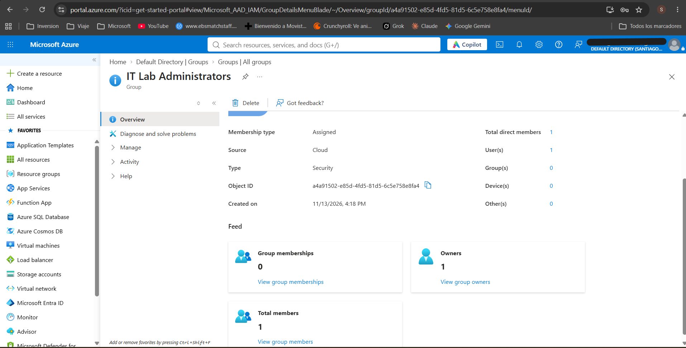
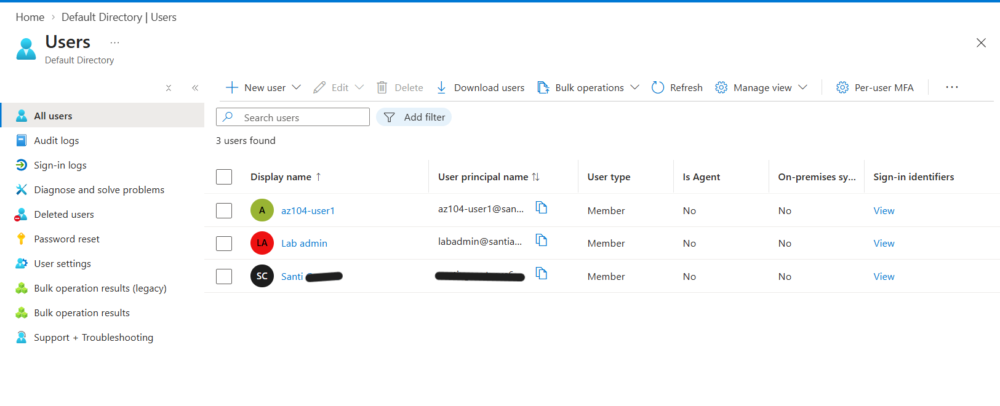
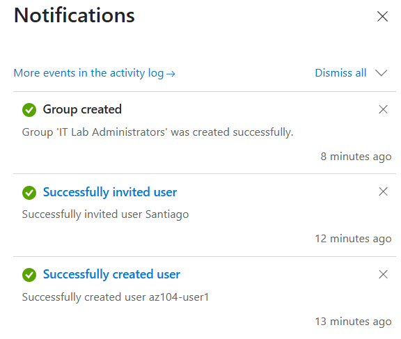

# Lab 01 — Manage Microsoft Entra ID Identities

**Date completed:** 2026-11-13  
**Study week:** Week 1 
**Time spent:** 6 minutes

---

## Objective

The objective of this lab was to learn how to manage user identities and groups using Microsoft Entra ID.

This included creating internal user accounts, inviting external guest users, configuring security groups and managing group ownership and membership.

These skills are essential for managing identities, controlling access and maintaining security in Microsoft Azure environments.

---

## Azure services used

- Microsoft Entra ID
- Microsoft Entra Users
- Microsoft Entra Groups
- Microsoft Entra B2B Collaboration

---

## Steps taken

### 1. Explore Microsoft Entra ID

Accessed Microsoft Entra ID through the Azure Portal and explored the tenant overview and identity management features.

Reviewed the tenant structure and its role in managing organizational identities.

### 2. Create and configure an internal user

Created a new user account with the following configuration:

| Property | Value |
|---|---|
| Username | az104-user1 |
| Display name | az104-user1 |
| Job title | IT Lab Administrator |
| Department | IT |
| Usage location | United States |
| Account status | Enabled |

Verified that the user account was successfully created.

### 3. Invite an external guest user

Used the Microsoft Entra external user invitation functionality to invite an external email address into the tenant.

Configured the guest user's properties, including display name, job title, department and usage location.

This demonstrated how Microsoft Entra B2B collaboration allows external users to access organizational resources.

### 4. Create and configure a security group

Created a security group with the following configuration:

| Property | Value |
|---|---|
| Group name | IT Lab Administrators |
| Group type | Security |
| Membership type | Assigned |
| Description | Administrators that manage the IT lab |

### 5. Configure group ownership and membership

Assigned my administrator account as the group owner.

Added the following accounts as group members:

- az104-user1
- External guest user

Finally, reviewed the group configuration to verify its members and owners.

---

## Issues encountered

No significant issues were encountered during this lab.

---

## Screenshots

### 1. Security Group Overview

Shows the configuration of the IT Lab Administrators security group, including its membership type and ownership.

### 2. User Accounts

Shows the internal user accounts created and managed during the lab.

### 3. Creation Confirmations

Shows the successful creation of the internal user, external guest invitation and security group.

---

## Key takeaways

- **Microsoft Entra ID tenants:** Understand how an organization's identities are managed within a dedicated directory.
- **Member vs Guest users:** Understand the difference between internal organizational identities and external users invited through B2B collaboration.
- **Security groups:** Learn how groups simplify identity management and access administration.
- **Group ownership:** Understand how group owners can manage membership and group settings.
- **Assigned membership:** Understand how administrators manually manage group members.
- **Dynamic membership:** Learned how membership can be automatically determined using user or device attributes. This was not configured during this lab.

---

## AZ-104 exam relevance

**Exam domain: Manage Microsoft Entra ID identities.**

This lab covers several important AZ-104 concepts:

- Creating and managing users.
- Inviting and managing external guest users.
- Creating and configuring groups.
- Managing group owners and members.
- Understanding assigned and dynamic group membership.

These capabilities are fundamental to identity management and access administration in Azure.