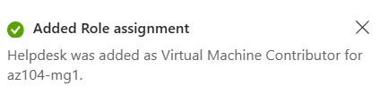
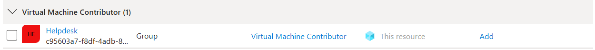
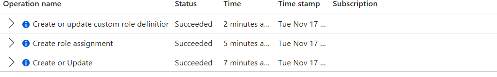

# Lab 02a — Manage Subscriptions and RBAC

**Date completed:** 2026-11-17  
**Time spent:** 15mins

---

## Objective

The objective of this lab was to understand how Azure Management Groups and Role-Based Access Control (RBAC) work together to manage permissions across multiple subscriptions.

The lab focused on organizing subscriptions using Management Groups, assigning built-in roles to groups, creating custom RBAC roles following the principle of least privilege, and monitoring role assignments through the Activity Log.

---

## Azure services used

- **Azure Management Groups** — Organizing subscriptions and managing access at scale.
- **Azure RBAC** — Controlling access through role assignments.
- **Microsoft Entra ID** — Managing users and security groups.
- **Azure Activity Log** — Monitoring administrative operations and role assignments.

---

## Steps taken

### 1. Implement Management Groups

Created a Management Group named `az104-mg1` to organize Azure resources and manage access at a higher scope.

Reviewed the management hierarchy and how permissions assigned at the Management Group level can be inherited by underlying subscriptions.

### 2. Assign a Built-in Azure Role

Reviewed the available built-in Azure roles and assigned the **Virtual Machine Contributor** role to the `Helpdesk` security group at the `az104-mg1` Management Group scope.

Created the Helpdesk security group in Microsoft Entra ID and added the appropriate user as a member.

Verified that the role assignment was successfully created.

This role allows the Helpdesk team to manage virtual machines without granting access to their operating systems or the associated virtual networks and storage accounts.

### 3. Create a Custom RBAC Role

Created a custom role named `Custom Support Request`.

The role was created by cloning the existing **Support Request Contributor** role.

Modified its permissions by excluding the `Microsoft.Support/register/action` permission using the `NotActions` configuration.

Configured `az104-mg1` as an assignable scope and reviewed the generated JSON definition before creating the role.

This demonstrates how custom roles can be used to implement the principle of least privilege.

### 4. Monitor Role Assignments with Activity Log

Reviewed the Activity Log at the Management Group level to monitor administrative operations.

Verified the successful completion of:
- Management Group configuration.
- Role assignment creation.
- Custom role definition creation.

---

## Issues encountered

**Problem:** Initially assigned the Virtual Machine Contributor role directly to my Guest user instead of a security group.

**Solution:** Recreated the assignment following Microsoft's recommended approach. Created a dedicated `Helpdesk` security group in Microsoft Entra ID, added the user as a member, and assigned the Virtual Machine Contributor role to the group.

**Key lesson:** Assigning permissions to groups rather than individual users simplifies access management and follows Azure RBAC best practices.

---

## Screenshots

### 1. Helpdesk Role Assignment

Shows the successful assignment of the Virtual Machine Contributor role to the Helpdesk security group at the Management Group scope.

### 2. RBAC Role Verification

Confirms that the Helpdesk group has the Virtual Machine Contributor role assigned.

### 3. Custom Role Creation

Shows the successful creation of the Custom Support Request custom role.

### 4. Activity Log Verification

Shows the successful completion of role assignments and custom role definition operations.

---

## Key takeaways

- Management Groups allow centralized organization and administration of Azure subscriptions.
- RBAC assignments can be made at different scopes, including Management Groups.
- Role assignments can be inherited by underlying resources and subscriptions.
- Assigning permissions to security groups is preferable to assigning them directly to individual users.
- Custom RBAC roles provide more granular control over permissions.
- `Actions`, `NotActions` and `AssignableScopes` define the permissions and scope of custom roles.
- The Activity Log provides visibility into administrative operations and role assignments.

---

## AZ-104 exam relevance

**Exam domain: Manage Azure identities and governance**

Topics covered:

- Azure Management Groups and subscription hierarchy.
- Built-in Azure RBAC roles.
- Role assignments and scopes.
- Security group-based access management.
- Custom RBAC role definitions.
- Actions, NotActions and AssignableScopes.
- Principle of Least Privilege.
- Monitoring administrative operations through Activity Log.

This lab provides practical experience with Azure governance and access management, which are essential skills for an Azure Administrator.