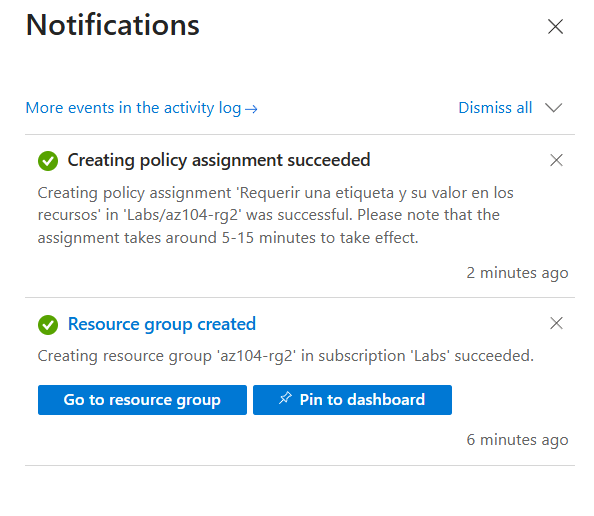
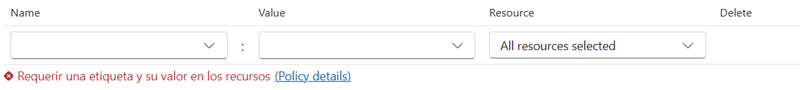
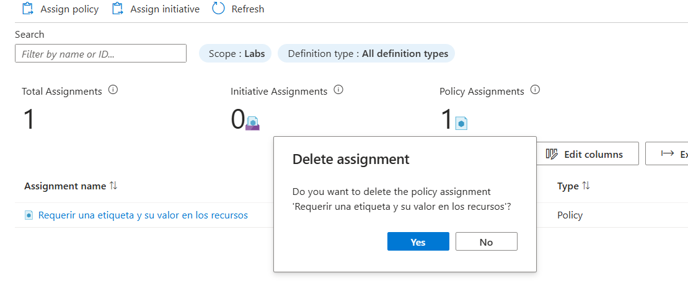
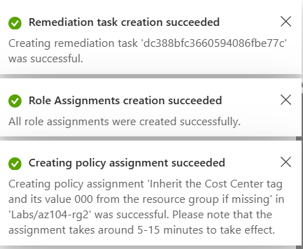
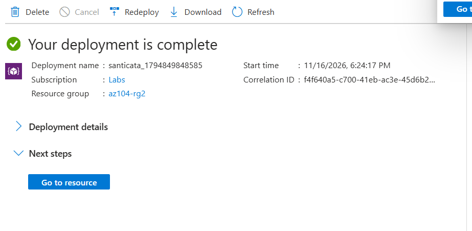
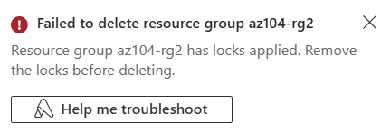

# Lab 02b — Manage Governance via Azure Policy

**Date completed:** 2026-11-16  
**Study week:** To be updated  
**Time spent:** To be updated

---

## Objective

The objective of this lab was to implement governance controls in Microsoft Azure using resource tags, Azure Policy and resource locks.

The lab focused on enforcing resource tagging requirements, automatically applying tags to resources through policy remediation, and protecting Azure resources against accidental deletion.

These capabilities are essential for maintaining governance, compliance and operational control in enterprise Azure environments.

---

## Azure services used

- Azure Resource Manager (ARM)
- Azure Resource Groups
- Azure Resource Tags
- Azure Policy
- Azure Policy Assignments
- Azure Policy Remediation
- Azure Managed Identities
- Azure Resource Locks

---

## Steps taken

### 1. Create a resource group and assign tags

Created a new resource group with the following configuration:

| Property | Value |
|---|---|
| Resource group | az104-rg2 |
| Region | East US |
| Subscription | Labs |
| Tag name | Cost Center |
| Tag value | 000 |

Assigned the Cost Center tag to the resource group to establish a governance standard.

### 2. Enforce tagging using Azure Policy

Located the built-in Azure Policy definition:

**Require a tag and its value on resources**

Created a policy assignment targeting the `az104-rg2` resource group.

Configured the following parameters:

| Property | Value |
|---|---|
| Policy | Require a tag and its value on resources |
| Assignment scope | az104-rg2 |
| Tag name | Cost Center |
| Tag value | 000 |
| Policy enforcement | Enabled |

Attempted to deploy a Storage Account without the required tag.

Azure Policy blocked the deployment because the resource did not comply with the assigned policy.

This demonstrated how Azure Policy can enforce governance requirements before resources are deployed.

### 3. Apply tagging through Azure Policy remediation

Removed the initial policy assignment and created a new assignment using the built-in definition:

**Inherit a tag from the resource group if missing**

Configured the policy to inherit the Cost Center tag from the parent resource group.

Created a remediation task to apply the policy to existing non-compliant resources.

Azure successfully created the remediation task and the required role assignments.

The subsequent deployment completed successfully.

### 4. Configure and test resource locks

Configured a resource lock on the `az104-rg2` resource group.

| Property | Value |
|---|---|
| Lock name | rg-lock |
| Lock type | CanNotDelete |

Attempted to delete the resource group to test the lock.

Azure prevented the deletion because the resource group had an active deletion lock.

This confirmed that resource locks can protect critical resources against accidental deletion, independently of the user's RBAC permissions.

---

## Issues encountered

**Problem 1: Storage Account deployment blocked by Azure Policy.**

Attempted to create a Storage Account without the required Cost Center tag.

**Solution:** This was the expected behaviour. Azure Policy denied the deployment because the resource did not comply with the assigned tagging requirements.

**Problem 2: Resource group deletion failed.**

After configuring the resource lock, Azure prevented the deletion of `az104-rg2`.

**Solution:** This was also expected behaviour. The deletion lock must be removed before the resource group can be deleted.

The resource group was still protected by the lock when the lab was completed.

---

## Screenshots

### 1. Resource Group and Initial Policy Assignment

### 2. Policy Enforcement - Deployment Denied

### 3. Policy Assignment Management

### 4. Policy Remediation and Role Assignments

### 5. Successful Deployment

### 6. Resource Lock - Deletion Prevented

---

## Key takeaways

- **Resource Tags:** Understand how key-value pairs can be used to organize resources, track ownership and allocate costs.

- **Azure Policy:** Learned how policy definitions enforce organizational standards and prevent non-compliant resource deployments.

- **Policy Effects:** Understand the difference between enforcing requirements through policy and modifying resources through remediation.

- **Policy Remediation:** Learned how remediation tasks can bring existing resources into compliance.

- **Managed Identities:** Understand why managed identities and role assignments are required for policies that modify resources.

- **Resource Locks:** Learned how CanNotDelete locks prevent accidental resource deletion, even when users have sufficient RBAC permissions.

- **Governance vs Access Control:** Understand the complementary roles of Azure Policy, RBAC and resource locks.

---

## AZ-104 exam relevance

**Exam domain: Manage Azure resources and governance.**

This lab covers important AZ-104 concepts:

- Assign and interpret Azure Policy definitions.
- Configure policy assignments and parameters.
- Enforce resource tagging requirements.
- Remediate non-compliant resources.
- Understand managed identities used for remediation.
- Configure and manage resource locks.
- Understand the relationship between Azure Policy, RBAC and resource protection.

These capabilities are essential for maintaining compliance and controlling resources in enterprise Azure environments.

---

## References

- [Microsoft Learn – Lab 02b: Manage Governance via Azure Policy](https://github.com/MicrosoftLearning/AZ-104-MicrosoftAzureAdministrator/blob/master/Instructions/Labs/LAB_02b-Manage_Governance_via_Azure_Policy.md)